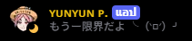

# Discord Bot
<p align = "center">
    <a href = "https://discord.com/oauth2/authorize?client_id=1367791789276401735&permissions=8&integration_type=0&scope=bot">
        <br>
    </a>
**Discord Bot** ー สำหรับใช้งานใน Server VoiceChat ทั่วไป<br>
“　ありがとうー！　”
</p>

# Function

- Radio (API)
    - COOLfahrenheit (Thai Radio Station)
    - Listen.moe (J,K-pop Radio Station)

- Notification [Join , Leave]
    All Flexibility to Customization
        - Server Join Message sent to chat
        - Server Leave Message sent to chat

## Setup

```powershell
python -m venv .venv
.\.venv\Scripts\python.exe -m pip install -r requirements.txt
Copy-Item .env.example .env
```

ตั้งคต่า `DISCORD_BOT_TOKEN` จาก DDP ลงใน .env และเริ่ม Run Bot :

```powershell
.\.venv\Scripts\python.exe main.py
```

เพิ่ม Function, Feature ของตนเองได้ที่ cogs/. 

## Requirements
ลง Plugin `ffmpeg.exe` ที่ Folder เดียวกันกับ main.py
## Bot Commands

Setup Bot :
```/setup```
Radio :
```/radio```